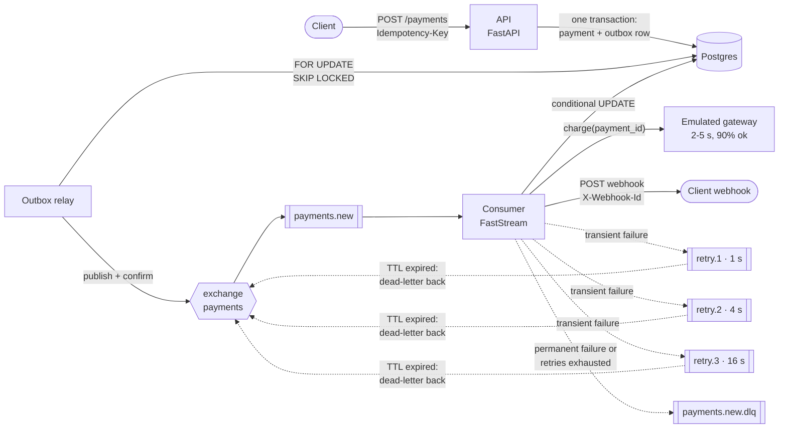

# outbox-payments

An asynchronous payment processing service, built as a **reference implementation**
of the patterns that keep a payment system from losing or double-charging money:

- a **transactional outbox** instead of a dual write to the database and the broker;
- **idempotent intake** on `Idempotency-Key` with `INSERT ... ON CONFLICT`;
- an **idempotent, resumable consumer** that can be killed at any line;
- **TTL-queue retries** with exponential backoff and a dead letter queue, no plugins;
- **hexagonal architecture** with dependency rules enforced by a test;
- **data-driven tests**: the business rules are readable tables in `tests/cases/`.

The code is small on purpose. The point is the reasoning, which lives next to it:
[`docs/ARCHITECTURE.md`](docs/ARCHITECTURE.md) (a system design write-up with
estimates, failure scenarios and production trade-offs) and the [ADRs](docs/adr/).

Python 3.14 (stdlib `uuid.uuid7()`), FastAPI, SQLAlchemy 2 (async), asyncpg,
Alembic, FastStream (RabbitMQ), httpx, pydantic v2. `uv`, `ruff`, `pyright --strict`.



---

## Quick start

Requirements: Docker with Compose v2, `make`, `curl`. For local development also
[`uv`](https://docs.astral.sh/uv/) (it installs Python 3.14 for you).

```bash
cp .env.example .env   # optional: every value has a default
make up                # build the image, start everything, wait for health checks
make demo              # scripted walkthrough of the flows below
```

| Service | URL |
|---|---|
| API (OpenAPI docs at `/docs`) | <http://localhost:8000> |
| RabbitMQ management (guest / guest) | <http://localhost:15672> |
| webhook-sink (demo receiver) | <http://localhost:8080/received> |

`make logs` follows all services, `make down` stops them and drops the volumes.

## API by example

All business endpoints need `X-API-Key` (default `dev-api-key`).

```bash
export API=http://localhost:8000 KEY=dev-api-key
```

**Create a payment** -> `202 Accepted`

```bash
curl -i -X POST $API/api/v1/payments \
  -H "X-API-Key: $KEY" -H "Idempotency-Key: order-42-attempt-1" \
  -H "Content-Type: application/json" \
  -d '{"amount": "100.00", "currency": "RUB", "description": "Order #42",
       "metadata": {"order_id": 42}, "webhook_url": "http://webhook-sink:8080/hook"}'
```

```http
HTTP/1.1 202 Accepted
location: /api/v1/payments/019a2b3c-4d5e-7f60-8a9b-0c1d2e3f4a5b

{"payment_id": "019a2b3c-4d5e-7f60-8a9b-0c1d2e3f4a5b", "status": "pending",
 "created_at": "2026-10-16T12:00:00.123456Z"}
```

**Repeat with the same key and body** -> the same `payment_id`, `202` again, no new
payment and no new event.

**Same key, different body** -> `409`

```bash
curl -s -X POST $API/api/v1/payments \
  -H "X-API-Key: $KEY" -H "Idempotency-Key: order-42-attempt-1" \
  -H "Content-Type: application/json" \
  -d '{"amount": "999.00", "currency": "RUB", "description": "Order #42",
       "metadata": {"order_id": 42}, "webhook_url": "http://webhook-sink:8080/hook"}'
```

```json
{"type": "/problems/idempotency-key-conflict",
 "title": "Idempotency key reused with a different request", "status": 409,
 "instance": "/api/v1/payments",
 "detail": "idempotency key 'order-42-attempt-1' was used with a different request"}
```

**Read it** (after 2-5 s it is `succeeded` or `failed`)

```bash
curl -s $API/api/v1/payments/019a2b3c-4d5e-7f60-8a9b-0c1d2e3f4a5b -H "X-API-Key: $KEY"
```

```json
{"id": "019a2b3c-...", "amount": "100.00", "currency": "RUB", "description": "Order #42",
 "metadata": {"order_id": 42}, "status": "succeeded", "idempotency_key": "order-42-attempt-1",
 "webhook_url": "http://webhook-sink:8080/hook",
 "created_at": "2026-10-16T12:00:00.123456Z", "processed_at": "2026-10-16T12:00:03.912345Z"}
```

**See the webhook**: `curl -s localhost:8080/received`, or `make logs` and look for
`logger=webhook_sink msg="webhook received"`.

Validation errors are RFC 9457 problem documents with an `errors` extension:

```json
{"type": "/problems/validation-error", "title": "Request validation failed", "status": 422,
 "instance": "/api/v1/payments",
 "errors": [{"field": "amount", "message": "Input should be greater than 0"}]}
```

### Retry -> DLQ demo

Option A, no restart: point a payment at the sink's always-failing endpoint.

```bash
curl -s -X POST $API/api/v1/payments \
  -H "X-API-Key: $KEY" -H "Idempotency-Key: dlq-demo-1" -H "Content-Type: application/json" \
  -d '{"amount": "10.00", "currency": "USD", "description": "DLQ demo",
       "metadata": {}, "webhook_url": "http://webhook-sink:8080/fail"}'
```

Option B: make the normal endpoint fail too: `WEBHOOK_SINK_FAIL=true docker compose up -d webhook-sink`.

Then open <http://localhost:15672/#/queues> and watch the message move through
`payments.new.retry.1` (1 s), `.retry.2` (4 s), `.retry.3` (16 s) and land in
`payments.new.dlq`. In the DLQ, "Get messages" shows the headers `x-retry-count: 3`,
`x-last-error: WebhookTemporarilyUnavailableError: receiver answered 500` and
`x-failed-at`. `curl -s "localhost:8080/received?payment_id=<id>"` shows four
deliveries with the same `X-Webhook-Id`.

The payment itself is `succeeded` or `failed`: the charge was committed before the
webhook was attempted. Only the notification is dead-lettered.

## Delivery guarantees

| Hop | Guarantee | How |
|---|---|---|
| Client -> API | exactly-once effect | `Idempotency-Key` + unique index + request fingerprint |
| API -> outbox | atomic with the payment | same Postgres transaction |
| Outbox -> RabbitMQ | **at-least-once** | relay marks rows published only after the broker's confirm; a crash in between republishes |
| RabbitMQ -> consumer | **at-least-once** | manual ack after the work is committed; durable queues, persistent messages |
| Consumer -> gateway | exactly-once charge | gateway idempotency key = payment id; conditional `UPDATE ... WHERE status='pending'` |
| Consumer -> webhook | **at-least-once** | `webhook_delivered_at` checkpoint; duplicates carry the same `X-Webhook-Id` so receivers can dedupe |

There is no exactly-once *delivery* anywhere; there are exactly-once *effects*,
because every consumer of a message is idempotent.

## What "3 attempts" means here

`MAX_RETRIES=3` (configurable) counts **retries after the first delivery**, so a
failing message is handled at most **4 times**: the original delivery, then after
1 s, 4 s and 16 s (one TTL queue each). The fourth failure goes to the DLQ.
`MAX_RETRIES=0` disables retries. The reasoning, and exactly which errors are retried,
are in [ADR 0005](docs/adr/0005-retry-interpretation.md).

| Retried | Straight to the DLQ | Neither (business outcome) |
|---|---|---|
| webhook 5xx, 408, 429, timeout, connection error; database or broker unavailable; unexpected errors | malformed message, unknown payment, webhook 4xx (except 408/429), webhook redirects | gateway decline: `failed`, webhook sent, ack |

## Project layout

```text
src/outbox_payments/
  domain/              Payment aggregate, PaymentStatus state machine, Money, Currency,
                       PaymentCreated event, request fingerprint. Pure Python.
  application/
    ports.py           Protocols: PaymentRepository, OutboxRepository, Transaction,
                       PaymentProvider, WebhookSender, EventPublisher, Clock
    use_cases/         CreatePayment, GetPayment, ProcessPayment, RelayOutbox
    outbox.py          OutboxMessage + event serialization
    webhooks.py        notification payload, HTTP status classification
    errors.py          transient vs permanent errors
  adapters/
    db/                SQLAlchemy models (Mapped[]), repositories, session factory
    messaging/         topology, retry policy, publisher, failure routing, schemas
    payment_provider/  EmulatedPaymentProvider (injected RNG and sleep)
    webhooks/          HttpxWebhookSender
  entrypoints/
    api/               FastAPI app, routers, schemas, problem details, deps (composition root)
    consumer.py        FastStream app (composition root of the consumer)
    relay.py           outbox relay process
    heartbeat.py       file heartbeat for worker healthchecks
  config.py            pydantic-settings
migrations/            Alembic, async env
tests/
  cases/               test DATA only, mirrors the test tree
  fakes/               in-memory port implementations (with real transaction semantics)
  support/             builders and Postgres/RabbitMQ plumbing
  unit/                domain, use cases, API, handler via TestRabbitBroker (no I/O)
  contract/            one suite per port, run against the fake AND the real adapter
  integration/         repositories, relay, TTL/DLX topology, crash scenarios (compose infra)
  e2e/                 the whole compose stack over HTTP
tools/webhook_sink/    demo webhook receiver
docs/                  ARCHITECTURE.md, adr/
```

Dependencies point inward only (`entrypoints -> adapters -> application -> domain`).
`tests/unit/test_architecture.py` parses every import with `ast` and fails the build
otherwise.

## Tests

```bash
make install           # uv sync
make lint typecheck    # ruff (lint + format check), pyright strict
make test-unit         # ~200 tests, no I/O, < 2 s
make test-integration  # starts postgres + rabbitmq from compose
make test-e2e          # starts the whole stack
```

| Level | What | Infrastructure |
|---|---|---|
| `unit` | domain, use cases on fakes, API through `httpx.ASGITransport`, the message handler through `TestRabbitBroker`, adapters with `httpx.MockTransport` | none; the clock, randomness and sleeping are injected, nothing ever waits |
| `integration` | SQL repositories, relay with two concurrent replicas, TTL/DLX on a real broker (TestRabbitBroker does not emulate them), crash scenarios | Postgres + RabbitMQ from compose (separate `payments_test` database) |
| `e2e` | create -> webhook; 5xx -> 3 retries -> DLQ; replay with the same key; RabbitMQ outage -> outbox catches up | the full compose stack |

The level comes from the directory (a conftest hook adds the marker), so a test
cannot be filed under the wrong one. Contract suites in `tests/contract/` take the
level from their backend parameter: the in-memory run is `unit`, the SQL run is
`integration`. If a fake drifts from Postgres semantics, the two runs disagree.

### Data-driven tests

Test logic and test data are separate ([ADR 0006](docs/adr/0006-data-driven-test-layout.md)).
`tests/cases/` mirrors the test tree and holds **data only**:

```python
# tests/cases/entrypoints/consumer.py
CONSUMER_OUTCOME_CASES: list[ConsumerOutcomeCase] = [
    {
        "id": "webhook-5xx-after-three-retries-goes-to-the-dlq",
        "failure": "webhook-5xx",
        "incoming_retry_count": 3,
        "expected_queue": "payments.new.dlq",
        "expected_retry_count": 3,
    },
    # ... one dict per rule
]
```

```python
# tests/unit/entrypoints/test_consumer.py
@pytest.mark.parametrize("case", as_params(CONSUMER_OUTCOME_CASES))
async def test_consumer_outcome(case: ConsumerOutcomeCase) -> None: ...
```

- Each case is a `dict` typed by a `TypedDict` in the same module, so pyright strict
  checks the data.
- The `"id"` is kebab-case, reads as a sentence, and becomes the pytest id.
- Request-shaped cases are a shared base payload plus `"overrides"`.
- Meta-tests (`tests/unit/test_case_modules.py`) enforce unique kebab-case ids,
  data-only modules (AST check: no functions, no calls but `Decimal()`, restricted
  imports) and the mirrored layout.

Tables in the suite: request validation, `Idempotency-Key` header rules, idempotency
outcomes (use case and HTTP), request fingerprint equivalence, money bounds, status
transitions, gateway outcome -> status + webhook payload, webhook status
classification, webhook response/exception -> ack/retry/DLQ, retry delays and the
DLQ cutoff, consumer outcome per failure kind, readiness, auth, layering rules.

## Configuration

Environment variables, see [`.env.example`](.env.example) and `src/outbox_payments/config.py`.
The interesting ones: `MAX_RETRIES`, `RETRY_BASE_DELAY_SECONDS`, `RETRY_BACKOFF_FACTOR`
(delay of retry *n* = base × factor^(n-1)), `RELAY_BATCH_SIZE`,
`RELAY_POLL_INTERVAL_SECONDS`, `OUTBOX_RETENTION_DAYS`, `CONSUMER_PREFETCH_COUNT`,
`WEBHOOK_TIMEOUT_SECONDS`, `PAYMENT_SUCCESS_RATE`.

Changing a retry delay changes a queue argument; RabbitMQ refuses to redeclare an
existing queue with different arguments, so delete the `payments.new.retry.*`
queues (or `make down`) after changing delays.
