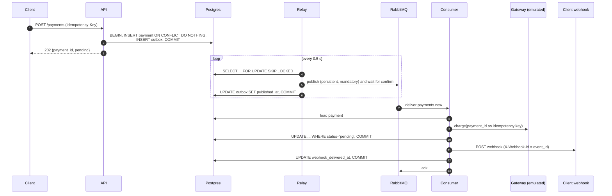

# Architecture

Written the way I would answer "design an asynchronous payment processing service"
in a system design interview: requirements first, then numbers, then the API and
data model, then a deep dive into each mechanism, failure modes, scaling and the
trade-offs I would revisit in production.

Decisions with real alternatives have ADRs in [`adr/`](adr/).

---

## 1. Requirements

### Functional

- `POST /api/v1/payments` accepts a payment (amount, currency RUB/USD/EUR,
  description, JSON metadata, webhook URL) and answers `202 Accepted` immediately.
- The request is idempotent on the `Idempotency-Key` header: the same key with the
  same body returns the original payment, the same key with a different body is a
  conflict.
- `GET /api/v1/payments/{id}` returns the payment and its current status.
- A background consumer "charges" the payment (2-5 s, 90 % success), stores the
  outcome (`succeeded` / `failed`) and notifies the client's webhook.
- Failures are retried 3 times with exponential backoff, then dead-lettered.
- Every endpoint is protected by a static API key.

### Non-functional

- **No lost payments, no double charges.** These two dominate every other concern.
- **Accepting a payment must not depend on the broker.** Processing may be delayed;
  intake may not.
- **Every step restartable.** Any process can be killed at any line and the system
  converges to the right state after a restart.
- Observable: structured logs with `payment_id` / `event_id`, liveness and readiness
  probes, inspectable queues.
- Latency: `POST` p99 dominated by one Postgres transaction (single-digit ms).
  End-to-end (accept -> webhook) dominated by the 2-5 s gateway.

### Out of scope

Real gateway integration, refunds, multi-tenant auth, PCI concerns, UI.

---

## 2. Back-of-the-envelope estimates

Assume a target of **1 M payments/day**, 10x peak-to-average.

| Quantity | Estimate |
|---|---|
| `POST` rate | 1 M / 86 400 s ≈ **12 rps** avg, **~120 rps** peak |
| `GET` rate (clients polling, ~5 per payment) | ~60 rps avg, ~600 rps peak |
| Postgres writes per payment | 2 inserts (payment + outbox, one tx) + 1 outbox update (relay) + 2 payment updates (consumer) = **5** -> ~60 writes/s avg, ~600 peak: comfortable for a single primary |
| Payment row | ~250 B fixed + description (≤ 500 B) + metadata (avg ~200 B, max 16 KiB) + URL ≈ **0.7 KB** with indexes -> ~0.7 GB/day, ~260 GB/year |
| Outbox | ~250 B/row, purged after 7 days -> ~7 M rows ≈ 2 GB steady state; the partial index covers only the unpublished backlog (≈ 0 rows when healthy) |
| Relay throughput | Sequential publish + confirm ≈ 1 ms on a LAN -> ~1 000 msg/s per replica; ~100x headroom |
| Consumer throughput | Sequential, ~3.5 s per message -> **0.29 msg/s ≈ 25 k/day** |
| Concurrency needed for 1 M/day | Little's law: 12 rps × 3.5 s ≈ **41 in flight** on average, ~420 at peak |

The last two rows are the headline: **the consumer is the bottleneck by design**
(the brief asks for exactly one), and it is a latency-bound workload, so the fix is
concurrency, not CPU. See section 6.

---

## 3. API and data model

### API

| Method | Path | Success | Errors (all `application/problem+json`, RFC 9457) |
|---|---|---|---|
| `POST` | `/api/v1/payments` | `202` `{payment_id, status, created_at}` + `Location` | `400` bad/missing `Idempotency-Key`, `401`, `409` key reused with another body, `422` validation |
| `GET` | `/api/v1/payments/{id}` | `200` full payment | `401`, `404`, `422` malformed id |
| `GET` | `/health` | `200` liveness, touches nothing | |
| `GET` | `/ready` | `200` database and broker reachable | `503` with per-check status |

Money is a JSON **string** (`"100.00"`) in responses and webhooks; floats never
touch amounts.

### Data model

```text
payments                                   outbox
──────────────────────────────────────     ───────────────────────────────────────
id                   uuid  PK (uuid7)       id            uuid  PK  (= event_id)
amount               numeric(18,2) >0       event_type    varchar(64)
currency             varchar(3) CHECK       aggregate_id  uuid       (= payment id)
description          text                   payload       jsonb
metadata             jsonb                  created_at    timestamptz
status               varchar(16) CHECK      published_at  timestamptz NULL
idempotency_key      varchar(255) UNIQUE    attempts      int default 0
request_hash         varchar(64)            last_error    text NULL
webhook_url          text
created_at           timestamptz            ix_outbox_unpublished (created_at, id)
processed_at         timestamptz NULL           WHERE published_at IS NULL
webhook_delivered_at timestamptz NULL       ix_outbox_published_at (published_at)
```

- **uuid7 keys** are time-ordered: inserts append to the right edge of the B-tree
  instead of splitting random pages, which keeps the primary key index compact and
  cache-friendly. They also sort by creation time for free.
- `request_hash` is the sha256 of the canonical request (ADR 0007).
- `webhook_delivered_at` is the consumer's second checkpoint; it is not exposed by
  the API.
- Status and currency use `CHECK` constraints instead of native enums, so adding a
  value is an ordinary migration.

---

## 4. Deep dives

### 4.1 Request flow



### 4.2 API idempotency

```sql
INSERT INTO payments (...) VALUES (...)
ON CONFLICT (idempotency_key) DO NOTHING
RETURNING id;
```

- A row back: we won; insert the outbox record in the same transaction and commit.
- No row: the key exists. Load it and compare `request_hash`: equal -> return it (202),
  different -> 409.

Why not `SELECT` then `INSERT`? Two concurrent retries would both see "absent" and
one would crash on the unique index. With `ON CONFLICT`, the unique index is the
arbiter. If the first transaction has not committed yet, Postgres makes the second
`INSERT` **wait** on the index entry, then returns no row once the first commits
(or inserts normally if it rolled back). The follow-up `SELECT` runs with a fresh
READ COMMITTED snapshot and sees the winner.

The use case commits **before** returning, so a 202 always refers to a durable
payment (ADR 0004).

### 4.3 Transactional outbox and relay

Writing the event in the payment's transaction makes "payment exists iff event
exists" a database invariant (ADR 0001). The relay is a separate process:

1. `SELECT ... WHERE published_at IS NULL ORDER BY created_at, id LIMIT n FOR UPDATE SKIP LOCKED`
2. Publish each row with publisher confirms, `mandatory=True` and `on_return_raises`
   (an unroutable message is an error, not a silent drop), persistent delivery.
3. `UPDATE outbox SET published_at = now()` for confirmed rows, `COMMIT`.

- **Replicas**: `SKIP LOCKED` makes concurrent relays take disjoint batches
  (integration test with two relays). Row locks are held from the `SELECT` to the
  `COMMIT`, i.e. across the publishes.
- **Broker down**: the first failing publish records `attempts`/`last_error` and ends
  the round (no point hammering a dead broker with the rest of the batch); the next
  round retries. Meanwhile the API keeps accepting payments.
- **Guarantee: at-least-once.** A crash after the confirm but before the commit
  republishes those rows. Exactly-once delivery is not achievable here;
  exactly-once *effects* are achieved by the idempotent consumer.
- **Purge**: published rows older than `OUTBOX_RETENTION_DAYS` are deleted on an
  interval, so the table does not grow without bound.
- **Shutdown**: SIGTERM is checked between rounds, never between publish and commit.

### 4.4 Consumer: an idempotent, resumable state machine

```text
load payment ── not found ──────────────────────────────────────> DLQ
     │
     ├─ status = pending ──> charge(payment_id) ──> UPDATE ... WHERE status='pending'
     │                                              COMMIT  (checkpoint 1)
     │
     ├─ webhook_delivered_at IS NULL ──> POST webhook ──> SET webhook_delivered_at
     │                                                    COMMIT  (checkpoint 2)
     └─> ack
```

Each redelivery re-enters at the first step whose effect is not committed yet:

- A crash before checkpoint 1 repeats the charge **with the same idempotency key**
  (the payment id), so the gateway returns the original outcome instead of charging
  again.
- A crash between the checkpoints skips the charge and resends the webhook.
- A crash after the webhook but before checkpoint 2 sends the webhook twice. Both
  carry the same `X-Webhook-Id`, so the receiver can deduplicate. **Webhooks are
  at-least-once.**
- The conditional `UPDATE ... WHERE status = 'pending'` makes a concurrent duplicate
  (two consumers, or a redelivery racing a slow original) harmless: the loser
  reloads and adopts the winner's outcome.
- A **decline** is a business outcome: `failed`, webhook sent, ack. It is never
  retried.

### 4.5 Retries and the DLQ

```text
                      ┌──────────── TTL 1 s ─── payments.new.retry.1 ◄─┐
 relay ──► [payments] ├──────────── TTL 4 s ─── payments.new.retry.2 ◄─┤ transient failure,
   exchange   │       └──────────── TTL 16 s ── payments.new.retry.3 ◄─┤ x-retry-count + 1
              ▼                                                        │
        payments.new ──────────────► consumer ─────────────────────────┤
              │ (reject = safety net)                                  │ permanent failure
              ▼                                                        ▼ or retries exhausted
        payments.new.dlq ◄───────────────────────────────────── x-last-error, x-failed-at
```

- One queue per delay level (no head-of-line blocking, no plugin: ADR 0002).
- The consumer republishes the failed message to the next level with publisher
  confirms **before** acking the original. A crash in between duplicates the message
  rather than losing it.
- `MAX_RETRIES=3` means three retries after the first delivery (ADR 0005).
- Classification: webhook 5xx/408/429/timeout/connection errors, database
  unavailability and unexpected errors are retried; malformed messages, unknown
  payments and webhook 4xx/3xx go straight to the DLQ.
- If republishing itself fails (e.g. a retry queue was deleted), the handler raises
  and FastStream **rejects without requeue**: the work queue's DLX moves the message
  to the DLQ. A requeue would redeliver it instantly and forever (an integration
  test measured ~4000 redeliveries in 5 s before this was fixed). If the connection
  itself is gone, the message stays unacked and RabbitMQ redelivers it on reconnect.

### 4.6 Webhooks

- `POST` with JSON body, `X-Webhook-Id` = event id, 5 s timeout, **one attempt per
  delivery** (backoff belongs to the queues, not to an in-process loop holding a
  consumer slot), **redirects not followed**.

---

## 5. Failure scenarios

| # | Failure | What happens | Covered by |
|---|---|---|---|
| 1 | API crashes before commit | Nothing stored, client sees an error and retries with the same key | unit: commit failure leaves no trace |
| 2 | API crashes after commit, before responding | Client retries with the same key and gets the same payment | unit + e2e: idempotent replay |
| 3 | Two concurrent requests, same key | Unique index serializes them; one inserts, the other returns it (or 409) | contract: taken key is not inserted again |
| 4 | **RabbitMQ down** | API keeps returning 202; relay records `attempts`/`last_error`; the outbox drains after recovery | e2e: stop/start rabbitmq |
| 5 | Relay crashes after confirm, before commit | Batch republished; duplicates absorbed by the consumer | unit: duplicate event |
| 6 | Two relay replicas | `SKIP LOCKED`: disjoint batches, every event published once | integration: concurrent relays |
| 7 | **Duplicate event** | Second delivery finds a final status and a delivered webhook: no charge, no webhook | unit + integration |
| 8 | **Crash after charge, before commit** | Redelivery charges again with the same key; the gateway replays the outcome; one charge | unit + integration |
| 9 | **Crash after commit, before webhook** | Redelivery skips the charge and sends the webhook | unit + integration |
| 10 | Crash after webhook, before marking it | Webhook sent twice with the same `X-Webhook-Id` | by design (documented) |
| 11 | Webhook 5xx / timeout | Retried after 1 s, 4 s, 16 s, then DLQ | unit table + e2e |
| 12 | Webhook 4xx | DLQ immediately, payment status unaffected | unit table |
| 13 | Malformed message | DLQ immediately | unit table |
| 14 | Postgres down | API answers 500 problem, `/ready` 503; relay rounds fail and retry; consumer retries via TTL queues | unit: database outage is retried |
| 15 | Crash between republish to retry queue and ack | Message duplicated, absorbed by idempotency | by design |
| 16 | RabbitMQ restart | Durable queues + persistent messages + confirms: nothing confirmed is lost | integration: delivery_mode=2 |
| 17 | SIGTERM | Relay finishes its round; consumer stops consuming and waits up to 30 s for in-flight messages | `stop_grace_period` in compose |

Known weakness: a Postgres outage longer than the whole backoff (21 s) dead-letters
the messages that hit it. They are replayable from the DLQ, but in production I
would pause consumption while the database is down (circuit breaker) instead of
burning retries.

---

## 6. Scaling and bottlenecks

1. **Consumer (the real bottleneck).** Sequential processing gives ~0.29 msg/s.
   Options, cheapest first:
   - Concurrency inside the process: handle up to `prefetch_count` messages at once
     (FastStream's subscriber concurrency or an `anyio` task group). The workload
     waits on I/O, so one process can hold hundreds of in-flight charges.
   - More replicas. **Already safe**: the conditional update and the gateway
     idempotency key make concurrent processing of the same payment harmless. The
     only thing lost is the "exactly one consumer" property the brief asked for.
2. **Webhooks inside the processing path.** A slow receiver (5 s timeout) holds a
   slot that could be charging. Split them: a `payments.webhooks` queue fed by the
   consumer (or by a second outbox event), with its own retry ladder. A bad receiver
   then only delays its own notifications.
3. **Relay.** ~1 000 msg/s per replica with sequential confirms. Pipelining confirms
   (publish the whole batch, then await all confirms) gives another order of
   magnitude; more replicas scale linearly thanks to `SKIP LOCKED`.
4. **Postgres.** ~600 writes/s at peak is easy. `GET` load can go to read replicas
   (reads tolerate replication lag; a client polling for a status already accepts
   eventual consistency). Partition `payments` by `created_at` when it reaches
   hundreds of GB; uuid7 keys keep partitions append-only.
5. **RabbitMQ.** Not a concern at these rates. For HA, use **quorum queues**
   (replicated Raft) instead of classic queues; TTL/DLX works with them.

---

## 7. Trade-offs, and what changes in production

**Why exactly one consumer?** It is what the brief asks for, and it keeps the demo
deterministic and the logs readable. Correctness does not depend on it, which is
the important part: everything a consumer does is guarded by idempotency keys and
conditional updates, so scaling out is a configuration change, not a redesign.

What I would change for production:

| Change | Why |
|---|---|
| **Separate webhook queue** | Decouples charging from notifying; a bad receiver no longer slows payments; independent retry ladders (webhooks deserve hours of backoff, not 21 s) |
| **`processing` status** | Today a payment is `pending` until the gateway answers. A `processing` state, set before calling the gateway, makes in-flight charges visible, lets a reconciler find charges stuck after a crash, and maps to the gateway's own states |
| **CDC instead of polling** | Debezium (or logical replication) streams outbox inserts from the WAL: no polling latency, no polling load, ordering per aggregate for free; the outbox table becomes a pure append log |
| **HMAC-signed webhooks** | `X-Signature: sha256=HMAC(secret, timestamp + body)` with a timestamp header, so receivers can verify origin and reject replays |
| **SSRF protection** | Webhook URLs are client-controlled: resolve and reject private, loopback, link-local and metadata ranges at send time (not just at validation, DNS can change), pin the resolved IP, allowlist ports. Redirects are already not followed |
| **Per-client API keys** | Hashed keys in a table, scopes, rotation, rate limits; the idempotency key becomes unique **per client**, not globally |
| **Readiness without the broker** | The API does not need the broker; gating readiness on it would remove healthy API pods during a broker outage (see ADR 0007) |
| **Quorum queues, retry ladder in hours** | HA for the broker; webhook retries that outlast a receiver's deploy window |
| **Reconciliation job** | Periodically compare `pending` payments older than N minutes with the gateway's records; the safety net for anything the state machine cannot see |
| **Metrics and tracing** | Outbox backlog size and age, retry/DLQ rates, gateway latency; propagate trace context through message headers |
